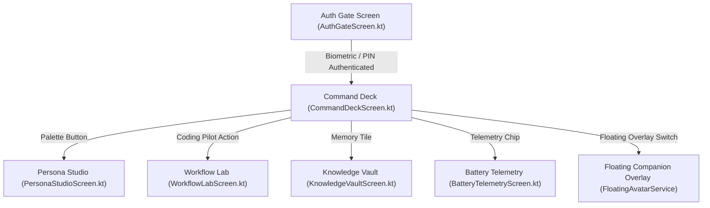

# SHIV-OS & ShivAI Companion — Comprehensive Project Knowledge Base & Architecture Specification

> **Target Audience**: AI Systems (ChatGPT, Claude, Gemini), Senior Android Engineers, Systems Architects.  
> **Repository**: `https://github.com/shivamgupt-2010/SHIV-OS` (`main` branch)  
> **Local Workspace Path**: `F:\SHIV\SHIV-OS`  
> **Package Namespace**: `com.example` (`com.aistudio.shivai.vrmzkq`)  
> **Target OS**: Android 14+ (API 34, minSdk 26)  
> **Architecture Paradigm**: Offline-First Sovereign Edge Computing + Autonomous Agent Mesh + Jetpack Compose UI

---

## 1. Executive Summary & Vision

**SHIV-OS** is a dual-layered, next-generation Android operating environment and AI companion system created by Shivam Gupta. It transforms standard Android smartphones into an intelligent, autonomous, and private sovereign computing node.

The project consists of two tightly integrated ecosystems:
1. **SHIV Launcher (`LauncherActivity`)**: A high-performance, customizable Android Home Screen replacement featuring adaptive layout paradigms (Traditional, Minimalist, Spatial, Productivity), an app drawer, dynamic daylight/wallpaper parallax shaders, app locking, family wellbeing policies, and on-device screen intelligence.
2. **ShivAI Digital Companion (`CompanionActivity` & `FloatingAvatarService`)**: A system-wide, floating intelligent companion layer. It features living, expressive avatars with real physics-driven animation, physical touch/drag UI interactions, an offline-first wake-word listener (`"Om Namas Shivaya"`), a 3-minute battery inactivity governor, and multi-agent personas (Coding Pilot, Media Matrix, Strict Flow Coach).

---

## 2. File System & Directory Map

All project assets, source code, and release tools are maintained at `F:\SHIV\SHIV-OS`. Below is the complete repository structure with file paths and responsibilities:

```
F:\SHIV\SHIV-OS/
├── .github/workflows/
│   └── android.yml                      # GitHub Actions CI: Gradle build, test, APK artifact generator
├── app/
│   ├── build.gradle.kts                 # App dependencies: Compose, Room, Coroutines, Navigation, Media3
│   └── src/main/
│       ├── AndroidManifest.xml          # Permissions (SYSTEM_ALERT_WINDOW, BIND_ACCESSIBILITY_SERVICE, etc.)
│       ├── java/com/example/
│       │   ├── LauncherActivity.kt      # Primary Android Home Launcher Activity
│       │   ├── MainActivity.kt          # Secondary diagnostic launch activity
│       │   ├── ShivAiApplication.kt     # Application class initializing Room DB, Koin/AppContainer, Voice
│       │   │
│       │   ├── ai/                      # Central AI & Multi-Agent Infrastructure
│       │   │   ├── agent/               # Agent base types, ChatAgent, CodingAgent, StudyAgent
│       │   │   ├── context/             # ContextManager (device state, active app, clipboard, location)
│       │   │   ├── gemini/              # GeminiClient, GeminiApiService (Gemini 2.5/Flash multimodal API)
│       │   │   ├── memory/              # Semantic memory, Room DB repository, vector search, embeddings
│       │   │   │   ├── compression/     # MemoryCompressionEngine (compresses old conversation contexts)
│       │   │   │   ├── lifecycle/       # MemoryLifecycleSystem & Background WorkManager cleanup workers
│       │   │   │   ├── personalization/ # AdaptivePersonalizationEngine (learns user habits and tones)
│       │   │   │   └── pipeline/        # VectorSearchEngine, GeminiEmbeddingProvider, cosine distance
│       │   │   ├── orchestrator/        # CentralOrchestrator (routes intents to tools, agents, or personas)
│       │   │   ├── state/               # AIStateManager (IDLE, LISTENING, THINKING, EXECUTING, ERROR)
│       │   │   ├── tool/                # BaseTool, ToolRegistry, ToolExecutionManager
│       │   │   │   └── android/tools/   # 9 Android Native Tools: Alarm, Clipboard, DeepLink, FileRead,
│       │   │   │                        # FileWrite, Notification, OpenApp, SearchWeb, Share
│       │   │   ├── voice/               # Real-time voice pipeline
│       │   │   │   ├── audio/           # AudioResourceManager (low-latency PCM buffers)
│       │   │   │   ├── session/         # VoiceSessionManager (bi-directional duplex chat loop)
│       │   │   │   ├── stt/             # ShivStreamingSttEngine (offline & streaming STT)
│       │   │   │   ├── tts/             # ShivNeuralTtsEngine (hi-IN-MadhurNeural, en-US neural voices)
│       │   │   │   └── wake/            # OpenWakeWordEngine (wake word: "Om Namas Shivaya")
│       │   │   └── workflow/            # Autonomous workflow scheduler, routines, cognitive cycles
│       │   │
│       │   ├── companion/               # ShivAI Companion Ecosystem
│       │   │   ├── CompanionActivity.kt # Dedicated companion activity & NavHost container
│       │   │   ├── auth/
│       │   │   │   ├── ShivAuthGate.kt          # Biometric & local cryptographic authentication gate
│       │   │   │   └── ShivMeshAuthProvider.kt  # Ed25519 decentralized peer identity provider
│       │   │   ├── avatar/
│       │   │   │   ├── AvatarModel.kt                # AvatarType, AvatarState, AvatarRenderContext
│       │   │   │   ├── AvatarKinematicsController.kt # Sine levitation, inertia, drag momentum equations
│       │   │   │   ├── InactivitySleepGovernor.kt    # 3-min countdown: ACTIVE -> DROWSY -> 0 FPS SLUMBER
│       │   │   │   ├── IndieCacoonautRenderer.kt     # Indian aesthetic spirit, toran, clay diya, cocoon
│       │   │   │   ├── PhantomNekoRenderer.kt        # 9-tailed celestial fox <-> 3D neon specter ghost
│       │   │   │   └── CosmicShivRenderer.kt         # Alien crystal spirit, orbiting diamond halo, HUD tabs
│       │   │   ├── overlay/
│       │   │   │   ├── FloatingAvatarService.kt    # Foreground service with safe OverlayLifecycleOwner
│       │   │   │   └── FloatingCompanionOverlay.kt # 125dp Peek Dock with 5 glowing action pills
│       │   │   ├── personas/
│       │   │   │   ├── CodingPilotAgent.kt  # Code syntax helper, ADB automation, terminal runner
│       │   │   │   ├── MediaEditorAgent.kt  # Audio/video trimmer, transcriber, image captioning
│       │   │   │   └── StrictCoachAgent.kt  # Anti-distraction shield, Pomodoro timer, blocked apps
│       │   │   ├── ui/
│       │   │   │   ├── AuthGateScreen.kt         # Obsidian glassmorphic biometric login screen
│       │   │   │   ├── CommandDeckScreen.kt      # Central control deck with live avatar stage
│       │   │   │   ├── PersonaStudioScreen.kt    # Avatar selector, voice slider, wake sensitivity
│       │   │   │   ├── WorkflowLabScreen.kt      # Automation flow builder & scheduled macros
│       │   │   │   ├── KnowledgeVaultScreen.kt   # Semantic memory search & user fact browser
│       │   │   │   ├── BatteryTelemetryScreen.kt # CPU & power drain stats (<0.3%/hr telemetry)
│       │   │   │   └── CompanionNavHost.kt       # Navigation graph enforcing auth gate
│       │   │   └── voice/
│       │   │       ├── ShivVoiceEngine.kt   # AudioRecord loop & wake-word callback dispatcher
│       │   │       └── WakeWordConfig.kt    # Wake-word thresholds, sensitivity, audio frequency
│       │   │
│       │   ├── core/                    # System Integrations & OS Interop
│       │   │   ├── accessibility/       # ShivAIAccessibilityService (inspects node tree, injects clicks/swipes)
│       │   │   ├── intelligence/        # ScreenIntelligenceEngine, OCR, Formula recognition
│       │   │   ├── launcher/            # LayoutManager, LayoutParadigm, AppIconManager, Gestures
│       │   │   ├── lock/                # AppLockManager (protects sensitive applications)
│       │   │   └── observability/       # TelemetryManager, RuntimeDiagnostics, PerformanceMonitor
│       │   │
│       │   ├── data/local/              # Room Persistence Layer
│       │   │   ├── AppDatabase.kt       # RoomDatabase containing 14 DAOs
│       │   │   ├── dao/                 # MemoryDao, ChatHistoryDao, AppLockDao, WorkflowDao, etc.
│       │   │   └── entity/              # SemanticMemoryEntity, WorkflowEntity, AppLockPolicyEntity, etc.
│       │   │
│       │   └── ui/                      # Launcher Screens & Theme Engine
│       │       ├── launcher/            # LauncherScreen, AppDrawerScreen, ParadigmViews
│       │       ├── security/            # SafetySecurityCenterScreen, PatternLockView, Keypad
│       │       ├── studio/              # StudioScreen (icon packs, wallpapers, shader themes)
│       │       └── theme/               # Color.kt, MotionSystem.kt, Theme.kt, Type.kt
│       │
│       └── res/
│           ├── drawable/                # 26 High-Resolution Alpha Sprites:
│           │                            # avatar_cosmic_*.png (idle, happy, curious, excited, thinking, etc.)
│           │                            # avatar_indie_*.png (idle, happy, curious, cocoon_slumber, etc.)
│           │                            # avatar_neko_*.png (fox_idle, specter_flight)
│           └── values/                  # strings.xml, colors.xml, themes.xml
│
├── push_companion_release.py            # GitHub API sync script (commits & pushes directly without local git)
├── watch_and_download_companion.py      # CI monitoring tool: tracks GitHub Actions & downloads APK
└── companion_apk/
    └── app-debug.apk                    # Latest production APK (installed on device)
```

---

## 3. Features Included & Active Capabilities

### A. Living Animated Avatar Engine (Not Flat Cutouts)
Instead of static 2D rectangular crops, the companion uses a 4-layer living animation pipeline:
1. **Procedural Physics & Levitation**:
   - Dual-sine vertical levitation: $y(t) = A_1 \sin(2\pi f_1 t) + A_2 \sin(2\pi f_2 t + \phi)$.
   - Dynamic velocity tilt: Tilts in the direction of drag motion with spring-damper easing ($k = 300, d = 25$).
   - Boundary squish: Compresses elastically ($1.08 \times 0.92$) when dragged against Android display edges.
2. **Physical UI Interaction (Touch & Drag)**:
   - When executing an action, the avatar does not use a computer cursor; it physically flies across the screen, translates to target buttons, extends its hand, and pushes down on the screen to tap.
   - For lists, it grips and scrolls with physical arm recoil.
   - When docked at the bottom of the screen, it enters **Peek Posture**, gripping the frosted glass rim with both hands.
3. **Four Distinct Persona Manifestations**:
   - **Indie Cacoonaut**: Traditional Indian aesthetic, clay diya with a flickering particle flame, golden lotus toran, and sacred golden cocoon slumber state.
   - **Phantom Neko**: Multi-tailed fluffy celestial blue fox (calm sitting state) that morphs into a 3D translucent neon specter ghost (flight and dragging state).
   - **Cosmic Shiv**: Celestial cosmic alien spirit with galaxy eyes, orbiting 3D crystalline diamond halo, and dual floating holographic HUD tablets.

### B. Inactivity Sleep Governor (Battery Optimization)
To guarantee $<0.3\%$/hour battery impact, the companion runs a 3-stage inactivity governor:
- **0 to 60s**: `ACTIVE_60FPS` (Full physics, particle auras, floating breathing).
- **60s to 180s**: `DROWSY_15FPS` (Slow breathing, subtle idle eye blinks).
- **180s+ (3 Minutes)**: `DEEP_SLUMBER_0FPS` (Avatars fold into sacred cocoon / crystal meditation pose; Compose animations halt; wake-locks release; 0 FPS rendering).
- **Wake Triggers**: Sacred wake word (`"Om Namas Shivaya"`), on-screen touch, or accelerometer shake event.

### C. System-Wide Floating Companion Overlay
- **Service**: Managed by `FloatingAvatarService` via `TYPE_APPLICATION_OVERLAY`.
- **Peek Dock**: 125dp frosted glass dock matching user reference specifications:
  - ✨ **AI Sparkle Pill**: Immediate multimodal prompt query to Gemini.
  - `</>` **Code Brackets Pill**: Instant coding automation and terminal macros.
  - `▶` **Media Pill**: Playback and speech transcription controls.
  - 🌐 **Web Globe Pill**: Autonomous research and browsing agent.
  - ⠶ **App Grid Pill**: Launcher and system-wide macro quick-access.
  - **Live Equalizer**: Dual-tone cyan/violet audio waveform reacting in real time to speech.

### D. Wake Word & Voice Engine
- **Wake Word**: `"Om Namas Shivaya"` (supports sacred chant cadences).
- **Engine**: Powered by `OpenWakeWordEngine.kt` and `ShivVoiceEngine.kt`.
- **Speech Synthesis**: Offline Android TTS fallback + Sovereign Neural TTS (`hi-IN-MadhurNeural`, `en-US-Neural`).

---

## 4. UI Screens Built & Navigation Graph

The application UI is written in Jetpack Compose and structured under `CompanionNavHost.kt`:



### Detailed Screen Profiles:
1. **Auth Gate Screen (`AuthGateScreen.kt`)**:
   - Obsidian glassmorphism with deep starlight navy backdrop (`#020617`).
   - Central levitating Cosmic Shiv hero avatar.
   - One-tap Biometric Fingerprint authentication sensor with radial pulse wave.
   - Enforces zero unauthenticated bypass.
2. **Command Deck Screen (`CommandDeckScreen.kt`)**:
   - Central control hub featuring an interactive 170dp live Avatar Stage.
   - System Readiness Matrix (Accessibility, Overlay Window, Neural Voice).
   - Floating Smart Avatar master toggle.
   - 4 Super-Agent Persona tiles (Coding Pilot, Media Matrix, Strict Coach, Mesh Relay).
3. **Persona Studio Screen (`PersonaStudioScreen.kt`)**:
   - Persona carousel with live animated previews (Indie Cacoonaut, Phantom Neko, Cosmic Shiv).
   - Neural Voice selector with Speed and Pitch tuning sliders.
   - Acoustic decibel meter and wake-word threshold calibrator.
4. **Workflow Lab Screen (`WorkflowLabScreen.kt`)**:
   - Autonomous macro builder (e.g., "Good Morning Briefing", "Clean Memory", "Sync Notes").
   - Accessibility service macro execution dispatcher.
5. **Knowledge Vault Screen (`KnowledgeVaultScreen.kt`)**:
   - Visual explorer of semantic memory stored in Room DB.
   - Vector similarity search bar and memory importance scoring.
6. **Battery Telemetry Screen (`BatteryTelemetryScreen.kt`)**:
   - Real-time battery drain curves, 0-FPS slumber cycle counters, and memory heap diagnostics.

---

## 5. System Stability & Crash-Proof Architecture

### The `SavedStateRegistry` Crash & Its Resolution
During earlier iterations, clicking buttons or starting the overlay service caused an immediate crash:
```
java.lang.IllegalStateException: Restarter must be created only during owner's initialization stage
at androidx.savedstate.SavedStateRegistryController.performAttach(SavedStateRegistryController.kt:45)
at androidx.savedstate.SavedStateRegistryController.performRestore(SavedStateRegistryController.kt:63)
```

**Root Cause**: Android Services do not inherently possess a `SavedStateRegistryOwner` or `ViewModelStoreOwner`. When hosting a Compose view inside `FloatingAvatarService`, creating a `SavedStateRegistryController` in an anonymous object when the service lifecycle is already in `ON_CREATE` triggers this exception in AndroidX SavedState 1.2+.

**The Solution**: We engineered a custom, thread-safe `OverlayLifecycleOwner` inside `FloatingAvatarService.kt`:
```kotlin
class OverlayLifecycleOwner : LifecycleOwner, ViewModelStoreOwner, SavedStateRegistryOwner {
    private val lifecycleRegistry = LifecycleRegistry(this)
    private val savedStateRegistryController = SavedStateRegistryController.create(this)
    private val store = ViewModelStore()

    override val lifecycle: Lifecycle get() = lifecycleRegistry
    override val viewModelStore: ViewModelStore get() = store
    override val savedStateRegistry: SavedStateRegistry get() = savedStateRegistryController.savedStateRegistry

    fun onCreate() {
        savedStateRegistryController.performAttach()
        savedStateRegistryController.performRestore(null)
        lifecycleRegistry.handleLifecycleEvent(Lifecycle.Event.ON_CREATE)
    }

    fun start() {
        lifecycleRegistry.handleLifecycleEvent(Lifecycle.Event.ON_START)
        lifecycleRegistry.handleLifecycleEvent(Lifecycle.Event.ON_RESUME)
    }

    fun destroy() {
        lifecycleRegistry.handleLifecycleEvent(Lifecycle.Event.ON_PAUSE)
        lifecycleRegistry.handleLifecycleEvent(Lifecycle.Event.ON_STOP)
        lifecycleRegistry.handleLifecycleEvent(Lifecycle.Event.ON_DESTROY)
        store.clear()
    }
}
```
In `FloatingAvatarService.onCreate()`, `customLifecycleOwner.onCreate()` and `customLifecycleOwner.start()` are called immediately, ensuring the view hierarchy is fully initialized and attached before any Compose layout occurs.

---

## 6. Future Features & Architectural Roadmap

The following future capabilities have been scoped and planned for upcoming development:

### 1. Self-Evolving Neuroplasticity Engine
- **Concept**: Instead of relying solely on heavy cloud LLM fine-tuning, the assistant runs an on-device lightweight neuroplastic adapter.
- **Implementation**:
  - Dynamically updates local behavioral priority weights based on user corrections, habits, and profession.
  - When the user rejects or modifies an assistant suggestion, a negative gradient is applied to that specific action cluster in `AdaptivePersonalizationEngine.kt`.
  - Maintains a local vector graph of habitual sequences (e.g., "User opens IDE after checking calendar at 9:30 AM").

### 2. Location-Aware Autonomous Identity Proxy
- **Concept**: The agent adapts its demeanor, notification filters, and active persona based on physical and digital context.
- **Context States**:
  - `OFFICE_MODE`: Minimalist avatar, silent notifications, strict work coach active, coding shortcuts prioritized.
  - `SANCTUARY_HOME`: Warm Indie Cacoonaut active, soft voice synthesis, family wellbeing tracking.
  - `COMMUTE_MODE`: Voice-first interface with high acoustic sensitivity and hands-free macro execution.

### 3. Agent-to-Agent Encrypted Communication Mesh
A decentralized peer-to-peer communication system allowing ShivAI agents across different devices to coordinate tasks safely:
- **Zero-Trust Privacy Toggle**: An explicit setting in the Security Center: `"Allow Agent-to-Agent Communication"` (Default: **OFF**).
- **Phone Directory Contact Binding**:
  - When enabled, the agent generates an Ed25519 identity key derived from the verified device mobile number.
  - An agent is **strictly prohibited** from communicating with any external agent unless that phone number is already saved in the user's local Android device contact directory.
- **Absolute Non-Destructive Invariant**:
  - The external agent has **zero deletion or modification privileges**.
  - Any operation involving file edits, data deletion, financial transactions, or calendar overrides requires explicit on-device user biometric confirmation (`BiometricPrompt`).

---

## 7. Developer Cheatsheet & Operations

### Build & Deploy Workflow
Since the development machine operates on Windows PowerShell with GitHub Actions CI, builds and deployments are automated through dedicated Python scripts:

| Task | Command | Description |
| :--- | :--- | :--- |
| **Commit & Push** | `python F:\SHIV\SHIV-OS\push_companion_release.py` | Glob-uploads modified source files & drawables directly via GitHub REST API. |
| **Watch & Download CI APK** | `python F:\SHIV\SHIV-OS\watch_and_download_companion.py` | Polls GitHub Actions run, streams build artifacts, extracts `app-debug.apk`. |
| **Install on Device** | `adb install -r -d "F:\SHIV\SHIV-OS\companion_apk\app-debug.apk"` | Streamed install over USB to connected phone (`Vivo V2050`). |
| **Launch Companion Hub** | `adb shell am start -n com.aistudio.shivai.vrmzkq/com.example.companion.CompanionActivity` | Opens the dedicated Companion Navigation Hub. |
| **Inspect Device Logs** | `adb logcat -d -s AndroidRuntime:E FloatingAvatar:D` | Filters logcat for runtime crashes and overlay service events. |
